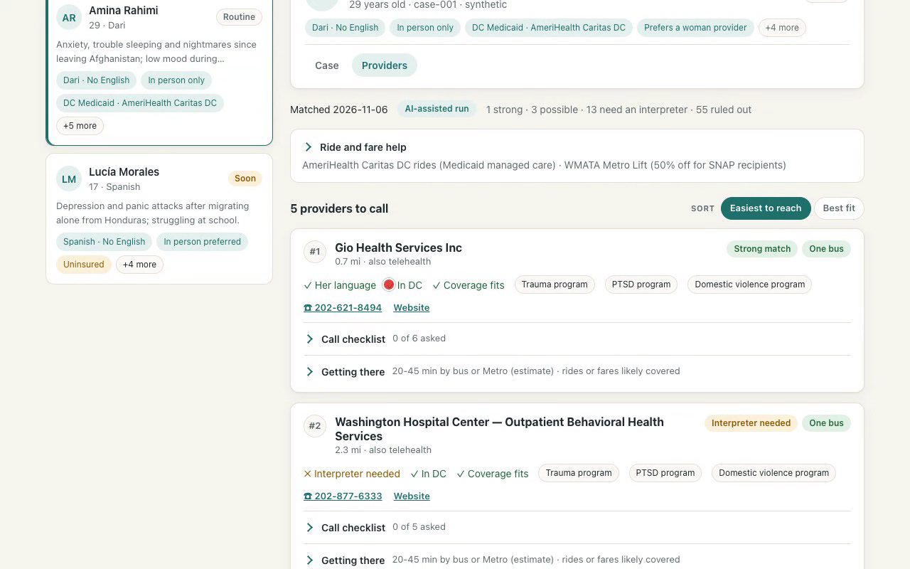
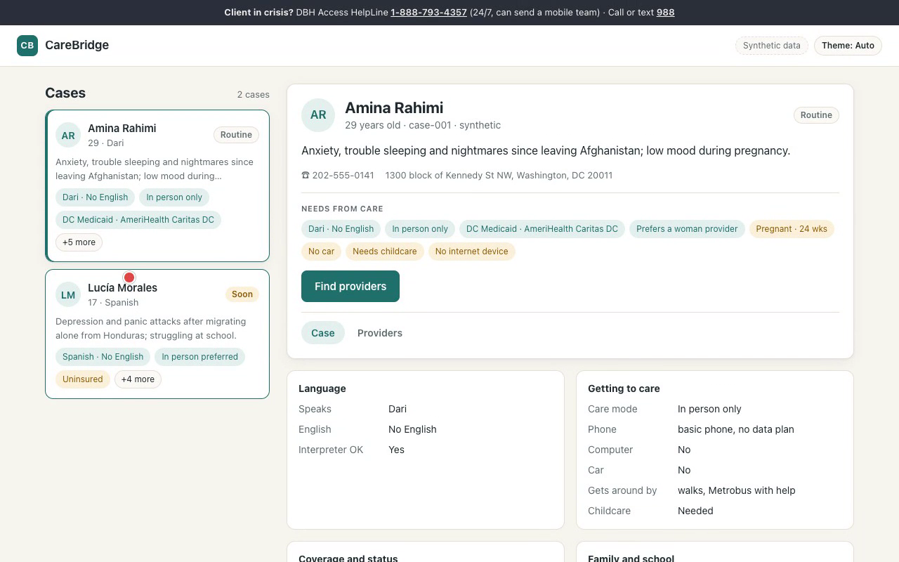
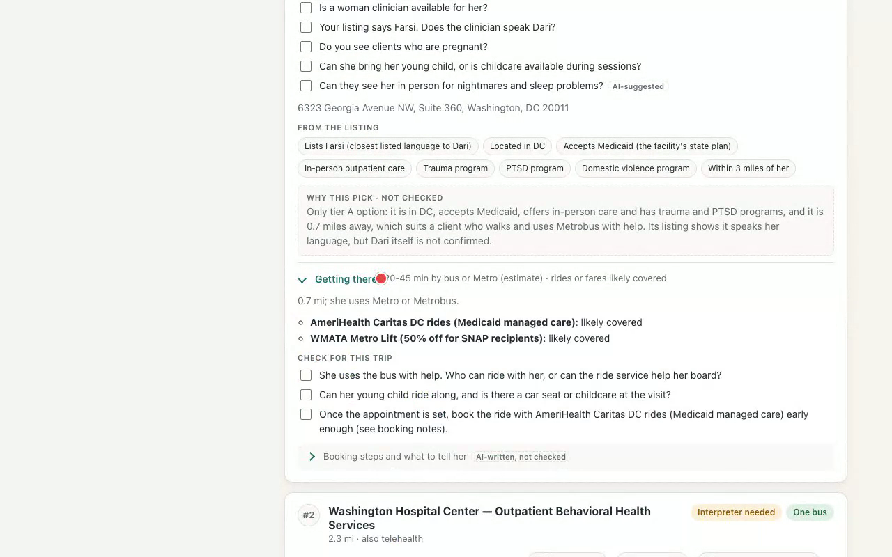

# CareBridge

Making mental health care reachable for immigrant, refugee and asylum-seeking women in the DC area.

CareBridge helps caseworkers turn a provider search into a practical plan: who to call, what to confirm, and how a client can get to care.

## Why I built this

This project started with a conversation with my friend’s mom, who runs IROC, a nonprofit that supports refugee and immigrant families in the DC area.

IROC helps with immigration, English classes, food and clothing. But she told me there’s one critical need they don’t have resources for: mental health care. Many of the women they serve are coming from war, or from countries where women have very few rights.

Today, their two case workers spend hours of their own free time searching for providers, reaching out, and asking the same questions every time: Does the provider speak her language? Is there a female provider? Can she get there without a car? Is it telehealth or in person? Do they accept Medicaid or other assistance programs?

The problem isn’t just finding care. It’s making care reachable.

So I built a tool that does that legwork for them.

## Demo

[](https://github.com/shreyahprasad/carebridge/blob/main/docs/media/carebridge-demo.mp4)

**[Watch the three-minute walkthrough](https://github.com/shreyahprasad/carebridge/blob/main/docs/media/carebridge-demo.mp4)** · MP4, silent · [Download video](https://github.com/shreyahprasad/carebridge/raw/refs/heads/main/docs/media/carebridge-demo.mp4)

The walkthrough uses synthetic cases and saved, validated results from live Claude runs. The browser reads these saved results; clicking **Find providers** opens the results view rather than making a new API request.

## What was built

1. **Caseworker dashboard.** A case list and case details bring together language, coverage, care mode, pregnancy, family needs and transportation barriers. Provider cards separate checked facts from AI-written notes, link to sources, and offer call checklists saved in the browser.
2. **Provider matching.** Python rules filter and tier 72 SAMHSA-listed mental health facilities within 10 miles of DC. Claude selects a shortlist from the eligible candidates. A validator checks provider IDs, tiers, factual claims and required questions before accepting the result.
3. **Transportation and benefits planning.** Rules grade reachability and identify potentially relevant ride and fare programs. A second Claude agent drafts booking steps from the checked shortlist and program notes. The handoff is checked against the original case and provider records before that agent runs.
4. **Provider call scripts.** A fixed Python template creates an opening, permitted client disclosures, exact questions, answer slots and follow-up tasks from validated match and trip results. This stage uses no AI. Scripts are saved as JSON; a call-script screen and automated calling are future work.
5. **Resource research pipeline.** A separate workflow researches providers, assistance and transport programs using Claude web tools, source excerpts and verification. The demo itself uses the curated provider and program files already in the repository.

For the saved Amina demo, provider matching narrows 72 listings to five picks. The trip view flags options that are not realistic without a car and adds ride or fare help to reachable options.

### Case overview



### Trip plan and call checklist



## Constraints and how they are handled

| Constraint | CareBridge’s approach |
| --- | --- |
| Language access | Tiers distinguish listed language matches from interpreter-dependent options. A Farsi listing still triggers a question to confirm Dari support. |
| Preference for a woman clinician | Recorded as a requirement to ask about; availability is never assumed from a facility listing. |
| Limited devices or internet | Care mode filters respect in-person and telehealth needs. A basic phone is not treated as video access. |
| Medicaid, no insurance or uncertain cost | Coverage rules guide matching; uncertain acceptance, out-of-state Medicaid and costs become call questions. |
| No car, young children or difficult travel | Distance and case circumstances drive reachability grades, ride-benefit checks and follow-up questions. Travel times are estimates, not live transit routes. |
| Incomplete provider information | Unknowns become explicit checklist questions, including new-patient availability, waitlists, pregnancy support and childcare. |
| AI errors or unavailable API | Structured outputs are validated. Failed match or trip generation falls back to rules-only results; an invalid cross-stage handoff stops the run. |
| Privacy | Model inputs omit direct client identifiers and immigration status. The call template excludes client name, phone, address, insurance plan name and immigration status. All committed cases are synthetic. |
| Human responsibility | Caseworkers confirm details and make calls. The script directs clinical, legal, crisis and payment issues back to a person. |

This is a prototype with researched program data, not independently verified eligibility or availability. AI-written explanations and trip prose are displayed separately as **“AI note · not checked.”** Validation checks structured facts and identifiers; it does not establish that free-text advice is correct. There is no real client intake, authentication, live routing or automated calling. Checklist ticks stay in local browser storage and are not shared between caseworkers.

## Libraries and Claude tools

| Component | Technology and purpose |
| --- | --- |
| Workflow logic | Python 3.14, with standard-library JSON, HTTP, file handling and offline `unittest` tests |
| Claude API | Anthropic Python SDK and the Messages API for provider shortlisting, trip-plan drafting and the separate research workflow |
| Data validation | Pydantic v2 for typed cases, provider records and stage results; JSON Schema validation for structured agent output |
| Interface | Plain HTML, CSS and JavaScript; no frontend framework or build step |
| Research tools | Claude `web_search` and `web_fetch` for finding resources and retrieving source pages |
| AI controls | Adaptive thinking, structured output validation, bounded requests and retries, and shared workflow budgets; match and trip agents have no web or other tools |
| Development | Claude Code, with project-defined roles for architecture, implementation, code review, verification and rendered UI review; synthetic fixtures support offline checks |
| Demo capture | Playwright with Chromium for the walkthrough; FFmpeg for video encoding and README screenshots |

## Run the browser demo

No API key, Python packages or frontend build are needed to view the committed demo results.

```sh
git clone https://github.com/shreyahprasad/carebridge.git
cd carebridge
python3 -m http.server 8000 --bind 127.0.0.1
```

Open **http://127.0.0.1:8000/ui/**, select a synthetic case, then choose **Find providers**. Both demo cases have saved match, trip and call-script outputs under `data/runs/`.

## Project layout

| Path | Contents |
| --- | --- |
| `ui/` | Caseworker dashboard and rendering logic |
| `match/` | Provider filters, tiers, Claude shortlist and validators |
| `trip/` | Reachability, benefit rules and Claude trip-plan workflow |
| `script/` | Deterministic call-script template and handoff checks |
| `research/` | Resource research and source checking |
| `data/` | Synthetic cases, provider records, programs and saved results |
| `tests/` | Offline checks for matching, transport and call scripts |
| `docs/media/` | Demo video and screenshots |
